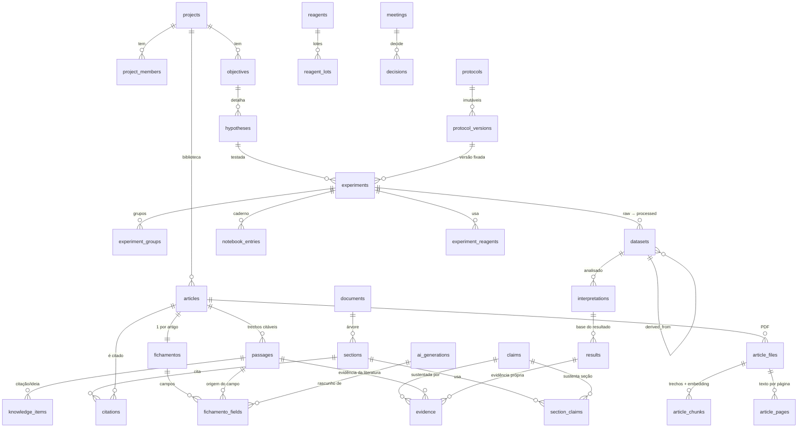

# ResearchOS — Arquitetura e modelo de dados

Sistema integrado de gestão de conhecimento, pesquisa e escrita científica, projetado para uma dissertação de mestrado.

> **Tese de design:** o valor não está em cada módulo isolado, e sim nas **ligações verificáveis** entre eles.
> Toda informação importante tem (1) uma **origem**, (2) um **estado de revisão humana** e (3) **arestas** que a conectam ao que a sustenta e ao que dela depende.

Prioridades (nesta ordem, quando há conflito): integração > quantidade de funcionalidades · rastreabilidade > automação cega · confiabilidade científica > geração de conteúdo · fluxo natural > complexidade.

---

## 1. As duas cadeias que o modelo precisa sustentar

**A. Sustentação (de baixo para cima)** — "de onde isto vem?"

```
Seção da dissertação ─uses_claim→ Afirmação ←about─ Evidência ─quotes→ Passagem ─belongs_to→ Artigo → PDF (página)
                                                         └─measured_in→ Resultado → Interpretação → Dado processado → Dado bruto
```

**B. Geração (de cima para baixo)** — "o que isto virou?"

```
Artigo → Passagem → Conhecimento (conceito/ideia/pergunta/lacuna) → Hipótese → Experimento → Resultado → Seção (Discussão) → Dissertação
```

Ambas existem no banco como **arestas**: parte são chaves estrangeiras tipadas (integridade forte), parte são `links` livres criados pelo pesquisador (flexibilidade). A view `v_edges` une as duas, e `trace_nodes()` / `trace_edges()` percorrem o grafo. Não há tabela separada de "grafo": o grafo **é** o modelo relacional.

## 2. Modelo de dados

Todas as tabelas de domínio têm `project_id` (denormalizado de propósito: RLS vira uma checagem barata e referências entre projetos são barradas por trigger).



| Grupo | Tabelas | Observações |
|---|---|---|
| Tenancy | `profiles`, `projects`, `project_members` | papéis `owner/editor/viewer` |
| Moldura | `objectives`, `hypotheses` | hipótese tem status (`proposed → testing → supported/refuted/inconclusive`) |
| Biblioteca | `articles`, `article_files`, `article_pages`, `article_chunks`, `passages` | `passages` é a **âncora de rastreabilidade** (artigo + página + trecho literal) |
| Fichamento | `fichamentos`, `fichamento_fields` | cada campo tem `origin`, `review_status`, `passage_id`, `ai_generation_id` |
| Conhecimento | `knowledge_items` (`concept/idea/question/quote/gap/contradiction`), `claims`, `evidence` | um só `knowledge_items` com `kind` evita 6 CRUDs idênticos |
| Experimental | `protocols`, `protocol_versions`, `experiments`, `experiment_groups`, `datasets`, `interpretations`, `results`, `notebook_entries`, `reagents`, `reagent_lots`, `experiment_reagents` | ver §5 |
| Gestão | `tasks`, `meetings`, `decisions` | ligáveis a qualquer nó via `links` |
| Escrita | `documents`, `sections`, `section_claims`, `citations` | seção é Markdown com marcadores `[@cite:id]` |
| Relações | `links` (polimórfica, validada por trigger) | `inspired_by, derived_from, supports, contradicts, tests, explains, answers, cites, used_in, related_to` |
| IA | `ai_generations` | contexto, modelo, parâmetros, trechos enviados, saída, revisão humana |
| Histórico/Busca | `change_log`, `search_index` | alimentados por triggers |

## 3. Proveniência e revisão humana

Duas enums transversais, presentes em tudo que a IA pode tocar (`fichamento_fields`, `knowledge_items`, `claims`, `evidence`, `hypotheses`, `interpretations`, `results`, `links`):

- `origin`: `source_extracted` · `ai_inferred` · `ai_suggested` · `researcher`
- `review_status`: `draft` · `approved` · `rejected`

Regras impostas **no banco** (não só na interface):

| Regra | Onde |
|---|---|
| Campo "extraído da fonte" exige `passage_id` (localizador) | `CHECK` em `fichamento_fields` |
| Fichamento só é aprovado quando nenhum campo está em rascunho; registra quem/quando | trigger `fichamento_approval_gate` |
| Número (`value`, `p_value`) só pode ter origem `researcher`/`source_extracted` — **nunca IA** | `CHECK` em `results` |
| Resultado `final` exige interpretação e aprovação humana | `CHECK` em `results` |
| Citação só liga passagem do próprio artigo citado | trigger em `citations` |
| Nenhuma referência cruza projetos | trigger `enforce_same_project` em ~25 tabelas |
| `status` da afirmação (`unsupported/supported/contested`) é **derivado** das evidências aprovadas | trigger em `evidence` |

Ao editar um campo gerado pela IA, ele passa a constar como `researcher` (a geração de origem continua registrada via `ai_generation_id`; o estado anterior fica em `change_log`).

## 4. Rastreabilidade na prática

- `v_nodes` (tipo, id, rótulo) e `v_edges` (dependente —relação→ fundamento) unificam FKs tipadas e `links`.
- `trace_nodes(tipo, id, profundidade)` e `trace_edges(...)` devolvem a vizinhança (sem direção, pois as duas cadeias misturam sentidos). Páginas `/p/:id/trace/:tipo/:id` mostram camadas por distância e a lista de relações com proveniência.
- Fichamento → campo → passagem → **link "abrir na página"** do PDF (`#page=N` em URL assinada).
- Dissertação: cada citação (`citations`) liga seção → artigo (→ passagem → página); `section_claims` liga seção → afirmação → evidência. A seção mostra **alertas de rigor** (citação órfã, metadados não confirmados, afirmação sem evidência/contestada).

## 5. Dados experimentais: raw → processado → interpretação → resultado

```
datasets(layer=raw) ──derived_from──▶ datasets(layer=processed, processing_method) ──▶ interpretations ──▶ results(status=final)
```

- **Raw imutável**: trigger bloqueia mudança de arquivo/hash/camada e `DELETE`; só `archived_at`. Upload usa `upsert:false` e hash SHA-256. Storage `lab-data` não tem política de update/delete.
- `processed` exige `derived_from` e método/script (reprodutibilidade).
- `protocol_versions` são append-only; o experimento fixa a **versão** usada.
- `notebook_entries`: após `signed_at`, conteúdo imutável; correção = nova entrada com `amends_id`.
- `reagent_lots` + `experiment_reagents` dão proveniência de material por experimento.

## 6. IA: contexto selecionável, sem invenção, tudo registrado

**Escopo de contexto** (`ai_generations.context_scope`): `source` (um artigo) · `library` · `project` · `dissertation` (artigos citados) · `system` (todos os projetos do usuário, ainda sob RLS).

**Camadas anti-alucinação** (`src/modules/ai/guardrails.ts`, testadas):

1. **Recuperação primeiro.** O assistente só vê blocos `[C#]` recuperados (texto + semântico, RRF). Sem blocos → **não chama o modelo** e responde "Não há informação suficiente na base de conhecimento".
2. **Citação verificável.** No fichamento, a citação da IA só vira `source_extracted` se existir **literalmente** (normalizada) na página do PDF; senão é rebaixada a `ai_inferred` e sinalizada.
3. **Números.** Todo número no texto gerado precisa existir na citação/fonte; caso contrário rebaixa/recusa (fichamento) ou invalida a resposta (assistente).
4. **DOI e referência nunca vêm do modelo.** DOI: regex sobre o texto do PDF. Referência ABNT: montada por código a partir dos metadados.
5. **Metadados** (título, autores, ano, periódico) sugeridos pela IA só são mantidos se aparecem nas primeiras páginas; ficam como "a confirmar" até o pesquisador aceitar.
6. **Registro.** Antes de cada chamada abre-se um `ai_generations` (contexto, modelo, parâmetros, prompt); depois fecha com status, tokens, trechos usados, relatório de verificação. A aprovação do fichamento marca a geração como revisada por humano.
7. `temperature = 0`; provedor atrás da interface `LlmProvider`.

## 7. Segurança

- **RLS em todas as tabelas.** Membros leem; `owner/editor` escrevem; apenas `owner` gerencia membros e apaga o projeto. Funções `is_member/can_edit/is_owner` são `SECURITY DEFINER` (evita recursão de RLS).
- `change_log` e `search_index` são só-leitura para usuários (escritos por triggers).
- **Storage** privado (`papers`, `lab-data`), caminho `{project_id}/...` com política baseada no primeiro segmento; acesso via URL assinada de curta duração.
- Chaves de IA ficam só no servidor; o navegador nunca chama o provedor.
- O cliente usa a sessão do usuário (anon key + JWT): **nenhuma** service-role key no app.

## 8. Arquitetura de código

```
src/
  app/            rotas (Server Components): só compõem dados + componentes
  components/     UI reutilizável (sem regra de negócio)
  lib/            supabase (server/session), auth, guard (erros de actions), tipos, env
  modules/<m>/    service.ts (regra de negócio, recebe o cliente Supabase)
                  actions.ts ('use server': valida form → chama service → revalida)
                  *.test.ts
    ai/ articles/ fichamento/ knowledge/ evidence/ experiments/ tasks/
    writing/ references/ search/ trace/ history/ assistant/ projects/
supabase/migrations/   0001 schema · 0002 RLS+integridade+busca+grafo · 0003 storage
supabase/tests/        stub do Supabase + testes de comportamento em SQL
```

Regra: páginas não têm lógica de domínio; serviços não conhecem React; só `ai/provider.ts` conhece o SDK do modelo.

## 9. Funcionalidade → entidades → relações → implementação no MVP

| Funcionalidade | Entidades | Relaciona-se com | Implementação no MVP |
|---|---|---|---|
| Auth | `auth.users`, `profiles`, `project_members` | todo dado via RLS | Supabase Auth e-mail/senha; trigger cria perfil; proxy protege rotas |
| Dashboard | consultas agregadas | tudo | contagens, pendências de revisão, tarefas, atividade (`change_log`) |
| Projeto/objetivos/hipóteses | `projects`, `objectives`, `hypotheses` | experimentos testam hipóteses; hipóteses/objetivos entram como contexto do campo "relevância" | CRUD + status da hipótese |
| Biblioteca + PDF | `articles`, `article_files/pages/chunks` | base de passagens, fichamento, citações, busca | upload → Storage; extração por página (`unpdf`); chunking com página; embeddings opcionais; DOI por regex |
| Fichamento com IA | `fichamentos`, `fichamento_fields`, `passages`, `ai_generations` | campos → passagens → artigo/página | gera **rascunho** verificado; revisão campo a campo; aprovação final com gate no banco |
| Conceitos/ideias/perguntas/citações/lacunas/contradições | `knowledge_items`, `links` | `passage_id` (origem); links para hipóteses, experimentos, seções | uma tabela com `kind`; citação exige passagem |
| Evidências/claims | `claims`, `evidence` | evidência → passagem **ou** resultado; claim → seção | status derivado por trigger; formulário de evidência |
| Experimentos/protocolos/resultados | `experiments`, `protocol_versions`, `datasets`, `interpretations`, `results` | hipótese ↔ experimento; resultado → evidência → claim → seção | camadas raw→processado→interpretação→resultado com travas no banco |
| Caderno | `notebook_entries` | experimento | assinatura imutável + correções |
| Reagentes | `reagents`, `reagent_lots`, `experiment_reagents` | experimento | catálogo, lotes (alerta de validade), uso por experimento |
| Tarefas/calendário/reuniões/decisões | `tasks`, `meetings`, `decisions` | `links` a qualquer nó | kanban por status; prazos; reuniões com decisões (**sem** visão de calendário ainda) |
| Dissertação | `documents`, `sections`, `citations`, `section_claims` | citação → artigo/passagem; seção → claim → evidência | árvore de seções, editor Markdown, citações ABNT, alertas de rigor, export `.md` |
| Referências | `articles` (metadados) + `references/abnt.ts` | `citations` | ABNT (NBR 6023/10520) gerada por código; metadados "a confirmar" sinalizados |
| Busca | `search_index`, `article_chunks` | todas as entidades | texto (tsvector, sem acento) + semântica (pgvector) fundidas por RRF; trecho de PDF volta com página |
| Grafo de conhecimento | `links` + FKs → `v_edges` | tudo | **MVP:** exploração por camadas/lista (`/trace`). Visual interativo fica para depois |
| Assistente | `ai_generations` | contexto selecionável | RAG com validação de citações/números; recusa sem base |
| Histórico/versionamento | `change_log`, `protocol_versions`, `ai_generations` | tudo | trigger genérico (antes/depois por linha); diff de campos na UI |

## 10. Limitações conhecidas do MVP (honestidade)

- **Não testado contra uma instância Supabase real** neste ambiente: o SQL foi validado em PostgreSQL 16 + pgvector com testes de comportamento (35 verificações, incluindo RLS com dois usuários); o app compila (`next build`) e a lógica de IA/validação tem testes unitários, mas as chamadas PostgREST/Storage/Anthropic não foram exercitadas ponta a ponta.
- Tipos do banco no TypeScript são manuais/soltos; rode `supabase gen types` e troque `Db` por `SupabaseClient<Database>`.
- PDFs **escaneados** não têm texto → sem fichamento/busca (OCR fora do MVP).
- Embeddings: gerados no import dos PDFs (se configurados). O `search_index` (notas, claims etc.) ainda **não** tem job de preenchimento de embeddings — a busca semântica atual cobre PDFs; as notas entram pela busca textual.
- Sem calendário visual, sem grafo visual, sem sugestão de links pela IA, sem colaboração em tempo real, sem exportação `.docx`.
- A verificação de citação é literal (normalizada): paráfrase correta marcada como "extraída" será rebaixada a "inferida" — decisão deliberada (falso negativo é aceitável, falso positivo não).

## 11. Próximos passos sugeridos (após validar o fluxo principal)

1. Rodar o fluxo real com 5–10 PDFs seus e medir quanto do fichamento sobrevive à verificação.
2. Job de embeddings para `search_index`; sugestão de links pela IA (sempre `ai_suggested`/`draft`).
3. Visão de grafo e de calendário; export DOCX/LaTeX.
4. OCR; importação por DOI/PubMed (metadados verificados em fonte externa).
5. Versões nomeadas ("snapshot") de seções e do documento inteiro.
